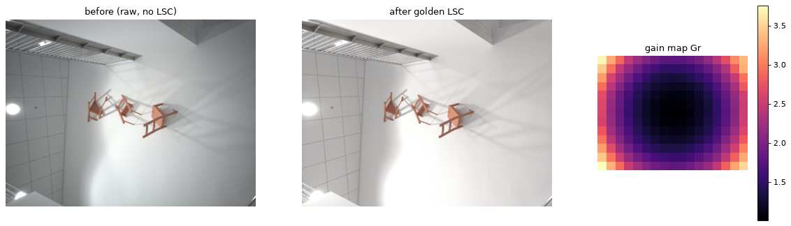

# XCam-Metal-ANE: Lens Shading Correction on Apple GPU and Neural Engine

Lens shading correction (LSC) on real phone raw frames, built three ways on the Apple
GPU with Metal, with a learned shading-grid estimator for the Apple Neural Engine (ANE)
planned next.

LSC fixes two lens defects: corners that are darker than the center (vignetting) and
color tints that change across the frame (color shading). The fix is simple: multiply
every raw pixel by a gain read from a small grid (e.g. 13 x 17 per color channel),
smoothly interpolated. The math is trivial, so the interesting part is moving
12 to 48 million pixels through memory as fast as the hardware allows.



*Raw frame from the HDR+ dataset. Left: no correction, with dark gray corners. Middle:
after golden LSC, evenly lit with no tint. Right: the 13 x 17 Gr gain map (up to ~4.4x in the corners).*

## Status

| Step | What | State |
|---|---|---|
| 1 | Python golden reference on HDR+ raw + real gain maps | Done |
| 2 | Metal kernels v1 / v2 / v3, verified and benchmarked | Done (GPU frame capture pending) |
| 3 | ANE model: estimate the gain grid from one scene, no flat field | Planned |
| 4 | End to end: ANE estimates the grid, Metal applies it | Planned |

## Data

[HDR+ Burst Photography Dataset](https://hdrplusdata.org/dataset.html) (CC BY-SA).
Each burst has raw DNG frames as captured on Android phones (Nexus 5/6/5X/6P, Pixel)
plus a low-resolution float gain map per frame, used to correct both vignetting and
color shading. This project uses the reference frame (`payload_N000.dng`) and its map
from all 153 bursts of the public subset (~3.1 GB, not committed).

| Sensor (raw size) | CFA | Grid | Bursts |
|---|---|---|---|
| 4208 x 3120 | BGGR | 13 x 17 | 75 |
| 4032 x 3024 | RGGB | 13 x 17 | 35 |
| 3280 x 2464 | RGGB | 10 x 13 | 26 |
| 4048 x 3036 | BGGR | 13 x 17 | 13 |
| other (3 types) | mixed | 13 x 17 | 4 |

## Conventions (all implementations must match)

1. **Channel order is [R, Gr, Gb, B].** The dataset documents the map as
   `[R, Gred, Gblue, B]`, where Gr is the green in the rows that contain red. This is
   *not* Android Camera2's `[R, G_even, G_odd, B]` (greens by row parity). On a BGGR
   sensor those two conventions swap the greens, so the CFA layout decides which green is which.
2. **Corner-aligned grid.** The first and last grid samples sit exactly on the image
   corners. For a half-resolution color plane of size Hp x Wp, plane pixel (x, y) reads
   the grid at `gx = x * (Nx - 1) / (Wp - 1)`, `gy = y * (Ny - 1) / (Hp - 1)`.
   GPU textures instead put samples at texel *centers*, so the sampler path must remap
   to `u = (gx + 0.5) / Nx`. Without this, the gain drifts by up to half a grid cell at the edges.
3. **Output** is normalized linear signal, unclipped:
   `(raw - black) / (white - black) * gain`.

The DNGs are uncorrected. Averaged over all scenes, raw corners are 0.6 to 0.75 of the
center brightness, and on near-flat scenes (above) the map flattens them.

## Metal kernels

| Version | Idea | Passes | DRAM bytes / pixel |
|---|---|---|---|
| v1 naive | float buffer, one thread per pixel, bilinear by hand | BLC + LSC | 6 + 8 = 14 |
| v2 sampler | grid in a 17 x 13 RGBA32F texture, hardware bilinear | BLC + LSC | 14 |
| v3 fused | one thread per 2x2 Bayer quad, half precision, black level fused in | 1 | 2 in + 2 out = 4 |
| copy | `ushort4` copy, same traffic as v3 | 1 | 4 |

v3 details:

- **One gain lookup serves 4 pixels.** All 4 pixels of a Bayer quad share the same
  plane coordinate, so one texture sample returns all four gains.
- **The host pre-swizzles the grid** into CFA raster order, so `texel.rgba` lines up
  with the quad's (0,0), (0,1), (1,0), (1,1) pixels with no per-pixel channel lookup.
- **Normalization costs nothing.** `1 / (white - black)` is folded into the grid on the
  host. The kernel does one subtract and one multiply per pixel, on `half4`.
- **Wide memory accesses.** Each thread does 2 x `ushort2` loads and 2 x `half2`
  stores, and neighboring threads touch neighboring addresses.

### Correctness vs Python golden (12 MP frame)

| Version | max abs error | max rel error | RMS |
|---|---|---|---|
| v1 | 2.4e-7 | 4.9e-7 | 6.7e-9 |
| v2 (fp32 texture) | 3.2e-4 | 7.3e-4 | 1.2e-5 |
| v2 (fp16 texture) | 6.2e-4 | 1.3e-3 | 2.1e-5 |
| v3 (half) | 9.0e-4 | 1.6e-3 | 2.6e-5 |

v1 matches to float precision. v2 is ~1e-3 off even with an fp32 texture, because the
hardware sampler computes its bilinear weights at reduced precision. That is a real
trade-off of "free" texture filtering, not a bug. v3's error is half-precision rounding
(about 11 bits), far below the 10-bit sensor's quantization step.

### Performance (Apple M5, MacBook Air)

Median GPU time over 15 command buffers, each running the kernel 10 times.
48 MP = the 12 MP frame tiled 2 x 2 (8096 x 6072). Peak = 153 GB/s (Apple's M5 spec).

| Kernel | 12 MP ms | 48 MP ms | 48 MP GB/s | % of peak |
|---|---|---|---|---|
| copy u16 (roofline) | 0.38 | 2.00 | 98.6 | 64 |
| v1 pipeline (BLC + LSC) | 2.08 | 7.80 | 88.3 | 58 |
| v2 pipeline (BLC + LSC) | 2.02 | 8.42 | 81.8 | 53 |
| **v3 fused half quad** | **0.52** | **2.03** | **96.8** | **63** |

What the numbers say:

- **LSC is memory-bound.** v1 and v2 both move data at ~85 to 90 GB/s, regardless of how
  the gain is interpolated. Across runs, v1 and v2 swap places, and their difference is within run-to-run noise.
  Swapping hand-written math for the texture sampler does not matter when the
  bottleneck is DRAM.
- **Cutting bytes is what wins.** v3 moves 4 bytes per pixel instead of 14, and is
  3 to 4.5x faster than the two-pass pipelines (range across runs).
- **v3 runs at the copy roofline.** At 48 MP, v3 (2.03 ms) is within ~2% of a plain
  copy with the same traffic (2.00 ms). There is no compute left to optimize: the only way to go faster is
  to move fewer bytes (e.g. fuse LSC into the next ISP stage).
- **Measured copy bandwidth is ~100 to 130 GB/s** (65 to 85% of the 153 GB/s spec).
  The 12 MP numbers are likely flattered by the on-chip system level cache. The 48 MP
  working set (~200 MB) does not fit, so those numbers reflect real DRAM.
- **Caveat:** the fanless MacBook Air throttles under sustained load. Run to run
  variation is about ±15 to 20%, while the ranking above is stable.

## Repo layout

```
scripts/            dataset tools (list bucket, download, inspect metadata)
python/lsc_ref.py   golden reference: load DNG + map, pack Bayer, upsample, apply
python/step1_reference.py     previews + golden binaries for the Metal check
python/check_shading_state.py averages many scenes to test if DNGs are pre-corrected
metal/lsc.metal     kernels: blc_f32, lsc_v1_naive, lsc_v2_sampler, lsc_v3_quad, copy_u16x4
swift/              LSCBench: verifies each kernel vs golden, then times 12 / 48 MP
out/metal/results.json        latest benchmark results
```

## Reproduce

Requirements: Apple silicon Mac, Xcode, [uv](https://github.com/astral-sh/uv).

```bash
uv venv --python 3.12 .venv
uv pip install --python .venv/bin/python rawpy tifffile numpy matplotlib torch coremltools
.venv/bin/python scripts/download_subset.py          # ~3.1 GB into data/hdrplus
.venv/bin/python python/step1_reference.py           # previews + out/golden
.venv/bin/python python/check_shading_state.py       # optional diagnostic
swift build -c release --package-path swift
swift/.build/release/LSCBench --reps 15 --batch 10   # add --capture with MTL_CAPTURE_ENABLED=1
```

Shaders compile at runtime from `metal/lsc.metal`. If `build/lsc.metallib` exists
(built offline with `xcrun metal`), it is used instead.

## Next: ANE grid estimator (Step 3)

Goal: estimate the shading grid from a single scene image, with no flat-field
calibration, to correct module-to-module variation or drift in the field. Plan:

- A tiny CNN: 4 x 48 x 64 downsampled raw in, 4 x 13 x 17 gain grid out.
  Trained in PyTorch, converted with coremltools to fp16 with fixed shapes.
- **Guard against shortcut learning.** Phones of the same model share nearly the same
  map, so a naive model could just learn "which phone is this". Training will divide
  each frame by its true map, then re-shade it with randomly altered maps (falloff,
  center shift, tint). Real maps stay as the held-out test set.
- Compare `cpuOnly`, `cpuAndGPU`, `cpuAndNeuralEngine`, and confirm in the Xcode
  Core ML performance report that every layer runs on the ANE. Also run the plain
  per-pixel multiply as a Core ML model, expected to lose to v3. The ANE is for
  learned estimation; the GPU is for per-pixel streaming.

## Citation

Data from the HDR+ Burst Photography Dataset:
S. W. Hasinoff, D. Sharlet, R. Geiss, A. Adams, J. T. Barron, F. Kainz, J. Chen,
M. Levoy. *Burst photography for high dynamic range and low-light imaging on mobile
cameras.* ACM Transactions on Graphics (Proc. SIGGRAPH Asia), 35(6), 2016.

Author: Xue -c
